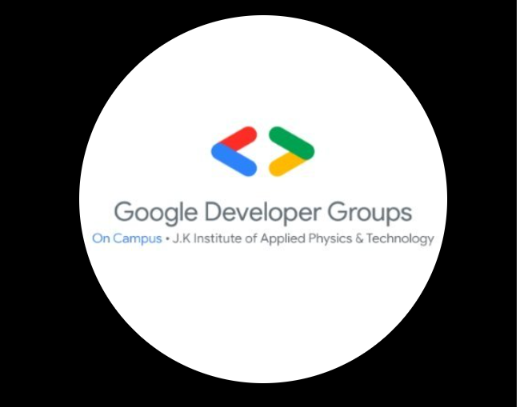

# Google Developer Groups On Campus — JKIAAPT

<p align="center">
  
</p>

<p align="center">
  <strong>Google Developer Groups On Campus — J.K. Institute of Applied Physics &amp; Technology</strong><br />
  <em>Build. Learn. Innovate. &bull; Learn. Build. Connect.</em>
</p>

<p align="center">
  <a href="https://www.instagram.com/gdgoc_ikiapt/"></a>
  <a href="https://www.linkedin.com/company/gdgoc-ikiapt/home/"></a>
  <a href="https://www.youtube.com/@GDGOC_IKIAPT"></a>
  <a href="https://x.com/gdgoc_ikiapt"></a>
  <a href="https://www.facebook.com/gdgoc.ikiapt/"></a>
</p>

<p align="center">
  
  
  
  
  
</p>

---

## 📌 Overview

A premium, production-quality web portal and social links hub for **Google Developer Groups On Campus — J.K. Institute of Applied Physics &amp; Technology (GDG On Campus, JKIAAPT)**.

Built with a modern developer-centric dark aesthetic, glassmorphism cards, glowing borders, dynamic particle constellations, and Google-inspired brand accents.

> "Connect with our community, explore our activities, and stay updated with the latest opportunities in technology."

---

## ✨ Features

- **🛡️ Authentic Brand Asset**: Uses the official circular GDG On Campus JKIAAPT emblem preserved in exact proportions and high fidelity.
- **💫 Ambient Glow & Halo Ring**: Custom conic-gradient entrance halo surrounding the hero emblem with pulsing Google brand hues (`#4285F4`, `#34A853`, `#FBBC05`, `#EA4335`).
- **🎴 Interactive Social Cards**: Dedicated glassmorphism cards with custom platform glow effects, badges, descriptions, and direct external navigation:
  - **Instagram**: Campus reels, highlights, behind-the-scenes stories.
  - **LinkedIn**: Professional networking, speaker announcements, and career sessions.
  - **YouTube**: Workshop replays, live sessions, and coding tutorials.
  - **X (Twitter)**: Instant announcements, tech threads, and live updates.
  - **Facebook**: Community photo albums, notices, and alumni connect.
- **🤝 About Our Community**: Structured cards covering the three core pillars:
  - **Learn** — Workshops, sessions, and technical learning.
  - **Build** — Projects, experimentation, and hands-on development.
  - **Connect** — Community, collaboration, and networking.
- **✨ Particle Constellation & Ambience**: Performant HTML5 Canvas floating constellation system with distance-based node connections.
- **🖱️ Desktop-Only Cursor Glow**: Subtle cyan/blue spotlight following mouse cursor on fine-pointer devices (automatically disabled on touch devices to conserve battery).
- **🎉 Interactive Micro-Interactions**: Confetti celebration trigger on community CTA buttons.
- **♿ Accessibility & Reduced Motion**: Keyboard accessible `:focus-visible` styling and strict compliance with `prefers-reduced-motion: reduce`.

---

## 🔗 Official Social Platforms

| Platform | Handle | Direct URL | Focus |
| :--- | :--- | :--- | :--- |
| **Instagram** | `@gdgoc_ikiapt` | [instagram.com/gdgoc_ikiapt](https://www.instagram.com/gdgoc_ikiapt/) | Campus stories, highlights & media |
| **LinkedIn** | `GDG On Campus JKIAAPT` | [linkedin.com/company/gdgoc-ikiapt](https://www.linkedin.com/company/gdgoc-ikiapt/home/) | Professional network & announcements |
| **YouTube** | `@GDGOC_IKIAPT` | [youtube.com/@GDGOC_IKIAPT](https://www.youtube.com/@GDGOC_IKIAPT) | Tech talks, workshops & demos |
| **X (Twitter)** | `@gdgoc_ikiapt` | [x.com/gdgoc_ikiapt](https://x.com/gdgoc_ikiapt) | Rapid updates & tech threads |
| **Facebook** | `gdgoc.ikiapt` | [facebook.com/gdgoc.ikiapt](https://www.facebook.com/gdgoc.ikiapt/) | Community notices & alumni |

---

## 🛠️ Tech Stack

- **Framework**: [React 19](https://react.dev/)
- **Build Tool**: [Vite 8](https://vite.dev/)
- **Language**: [TypeScript](https://www.typescriptlang.org/)
- **Styling**: [Tailwind CSS v4](https://tailwindcss.com/)
- **Icons**: [Lucide React](https://lucide.dev/) & Custom SVG Brand Icons
- **Effects**: [Canvas Confetti](https://github.com/catdad/canvas-confetti)
- **Typography**: [Outfit](https://fonts.google.com/specimen/Outfit) & [Plus Jakarta Sans](https://fonts.google.com/specimen/Plus+Jakarta+Sans)

---

## 📂 Project Structure

```
gdg/
├── public/
│   ├── images/
│   │   └── gdg-logo.png             # Official GDG On Campus JKIAAPT logo
│   └── favicon.svg                  # Site favicon
├── src/
│   ├── components/
│   │   ├── AboutSection.tsx         # "A Community That Builds Together" & feature cards
│   │   ├── BackgroundEffects.tsx    # Canvas constellation & cursor ambient glow
│   │   ├── BrandIcons.tsx           # Scalable SVG brand icons
│   │   ├── ClosingCta.tsx           # "Your Developer Journey Starts Here" CTA
│   │   ├── Footer.tsx               # Branding, social icon row, dynamic copyright
│   │   ├── Hero.tsx                 # Logo halo, headline, and dual CTAs
│   │   ├── Navbar.tsx               # Fixed glass header with mobile drawer
│   │   ├── SocialCard.tsx           # Individual glowing card component
│   │   └── SocialCardsSection.tsx   # Responsive grid of 5 platforms
│   ├── data/
│   │   ├── features.ts              # Learn, Build, Connect config
│   │   └── socialLinks.ts           # Central configuration array of all socials
│   ├── types.ts                     # TypeScript interfaces
│   ├── App.tsx                      # Root application layout
│   ├── index.css                    # Tailwind v4 theme, glassmorphism, animations
│   └── main.tsx                     # React application entry point
├── index.html                       # HTML head with fonts and metadata
├── package.json                     # Dependencies and scripts
├── tsconfig.json                    # TypeScript compiler configuration
└── vite.config.ts                   # Vite configuration with Tailwind CSS plugin
```

---

## 🚀 Getting Started

### Prerequisites

- [Node.js](https://nodejs.org/) (v18.0.0 or higher recommended)
- [npm](https://www.npmjs.com/) (v9.0.0 or higher)

### Installation

1. **Clone or navigate into the repository**:
   ```bash
   cd GDGoc_jkiapt
   ```

2. **Install dependencies**:
   ```bash
   npm install
   ```

3. **Start the local development server**:
   ```bash
   npm run dev
   ```
   Open your browser at `http://localhost:5174/` (or the port specified in terminal).

4. **Build for production**:
   ```bash
   npm run build
   ```

5. **Preview production build locally**:
   ```bash
   npm run preview
   ```

---

## 🎨 Design System & Color Palette

| Token | Hex / HSL | Usage |
| :--- | :--- | :--- |
| **Dark Canvas** | `#06080F` | Deep background surface |
| **Card Surface** | `rgba(13, 18, 34, 0.7)` | Glassmorphism card fill with blur |
| **Google Blue** | `#4285F4` | Primary brand accent & Learn pillar |
| **Google Green** | `#34A853` | Secondary brand accent & Build pillar |
| **Google Yellow** | `#FBBC05` | Amber highlight & Connect pillar |
| **Google Red** | `#EA4335` | YouTube card accent & halo gradient |
| **Cyan Glow** | `#00F0FF` | Ambient background glow & hero gradients |

---

## 📄 License

This project is created for **Google Developer Groups On Campus — J.K. Institute of Applied Physics & Technology (JKIAAPT)**.
All brand marks, logos, and emblems belong to Google and GDG On Campus.
Code is licensed under the [MIT License](LICENSE).
